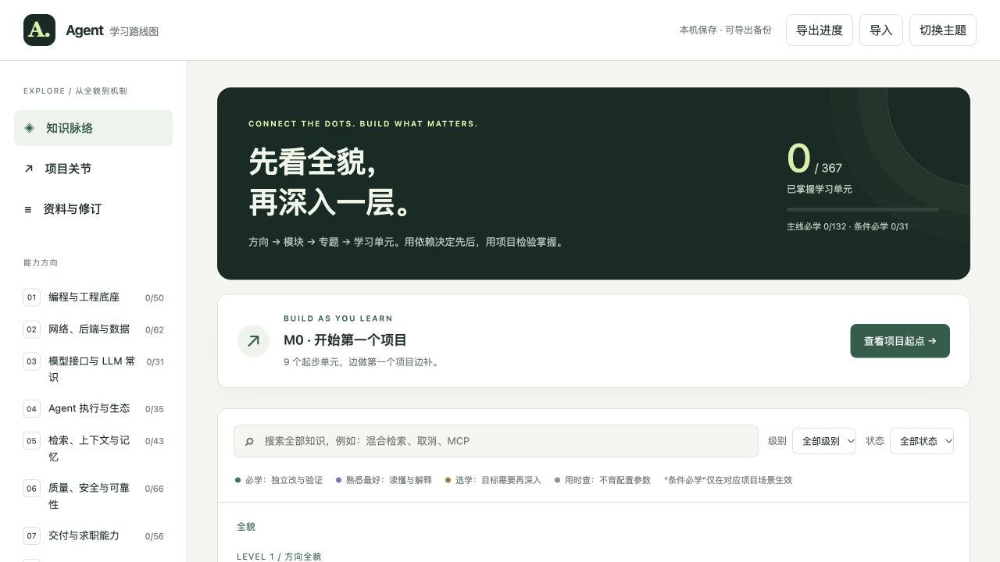

# AI Agent 后端学习路线图

一份面向 Python 后端与 Agent 应用的交互式学习路线。按方向、模块、专题和学习单元逐层浏览，结合前置关系与项目验收点安排实践。



覆盖 8 个方向、39 个模块、120 个专题和 367 个学习单元；侧边栏可进入某一方向，搜索框可跨方向查找具体知识。

## 主要功能

- 分层知识网络、依赖关系、搜索和优先级筛选。
- 七个项目验收节点，区分知识自评与实际项目完成情况。
- 本机浏览器保存学习状态和备注，支持 JSON 导出与导入；没有账号系统或后台同步。
- 资料来源和修订记录可在站内查看，路线图与来源说明可下载。

## 本地运行

需要 Python 3；项目运行时无需安装其他依赖。从仓库根目录执行：

```bash
git clone https://github.com/Mersolceil/agent-backend-roadmap.git
cd agent-backend-roadmap
python3 -m http.server 8770 --bind 127.0.0.1 --directory dist
```

在浏览器打开 `http://127.0.0.1:8770`。网页通过 HTTP 加载数据，直接双击 HTML 文件可能无法正常读取。

## 维护内容

- `dist/`：网站文件及可下载的路线与来源说明。
- `research/knowledge-v1.json`：用于迁移与生成的早期知识数据。
- `build_curriculum.py`：基于上述数据生成 `dist/knowledge.json`，并检查依赖与节点引用。更改数据后运行 `python3 build_curriculum.py`；下载版 Markdown 需根据修改同步维护。
- `scripts/check.py`：检查数据关联、依赖环、网页资源、下载版内容及 JSON 是否可重建；在临时目录构建，不会覆盖当前文件。

## 检查修改

```bash
python3 scripts/check.py
node --check dist/app.js
```

第一条命令只需要 Python 3；第二条需要 Node.js。GitHub Actions 会在推送和拉取请求时运行相同检查。它们不能代替浏览器中的交互检查，也不验证外部资料是否仍然有效。

## 资料与范围

这是一份学习建议，不是岗位要求统计、能力认证或求职结果保证。公开文档、规范和博客在站内标注链接；部分整理笔记未公开，其原文未包含在仓库中，无法由读者独立核验。资料整理日期为 2026 年 10 月，接口和版本请以官方最新文档为准。

本项目在资料整理、内容生成、代码和文档工作中使用了 AI 辅助。请结合实践验证内容；静态地图不能证明使用者已经掌握相关技能。

学习进度保存在当前浏览器，清除浏览器数据可能导致丢失；需要迁移时请自行导出备份。
