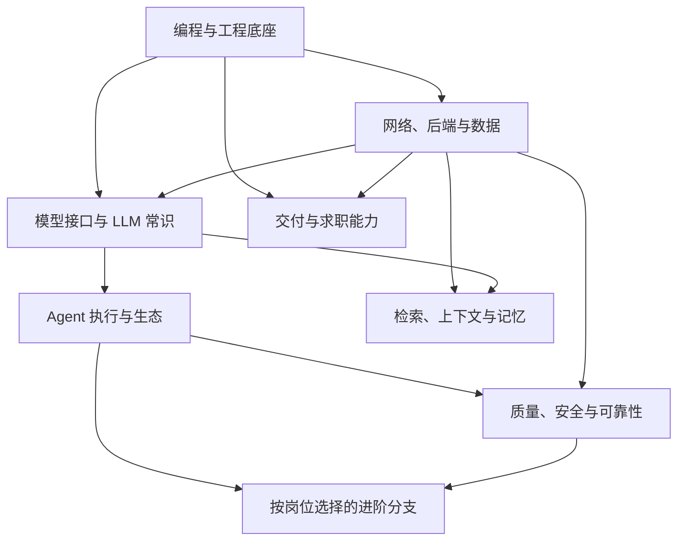

# AI Agent 后端学习路线图 · 分层版

编制：2026-10-27

方向 → 模块 → 专题 → 学习单元。按可独立练习的机制组织；条件必学仅在对应功能出现时进入。

## 项目关节

### M0 · 开始第一个项目

9 个合并后的起步学习单元。边学边做一个读取数据、过滤去重、输出结果的命令行工具，不必先学完整语言。

学习单元：A01, A03, B01, B03, B05, C01, C03, C04, D01

- [ ] 读取自己的 10 条数据，完成一次筛选与去重
- [ ] 独立修改一个条件，缺字段时不崩溃
- [ ] 查看 diff 并提交一次可解释的修改

### M1 · 开始 LLM 小项目

加入一次真实模型调用，输出通过本地校验；能处理超时与坏 JSON，记录调用费用。可以做信息提取，不要求此时就有 Agent。

学习单元：E01, E02, E03, E04, E05, E06, F01, F02, F03, F04, G01, G02, G03, G04, G05, G06, G07, H01, H02, H05

- [ ] 一次真实 API 调用，结构化输出通过本地校验
- [ ] 能复现并处理超时、鉴权失败或坏 JSON
- [ ] 说清请求内容、模型输出、费用与错误位置

### M2 · 完成后端服务项目

别人能按文档启动并调用接口；数据落库、错误可查、重启不丢数据。可与 Agent 分支并行，无需先做公网网站。

学习单元：I01, I02, I03, I04, I05, I06, J01, J02, J03, J04, J05, J06, J07, P01, P02, P03, P04, P05

- [ ] 别人按 README 能启动、调用接口
- [ ] 数据库重启后数据仍在，参数化 SQL 正确
- [ ] 非法输入返回明确错误，日志可定位问题

### M3 · 开始可控 Agent 项目

从单用户、同步、只读工具开始。数据库恢复、异步并发和写入幂等在加入对应功能时补齐，不阻塞第一个 Agent。

学习单元：L01, L02, L03, L04, L05, L06, L07, O01, O02, O03, O07, N01, N02, N04

- [ ] 只读工具完成多步任务，调用与结果可追踪
- [ ] 参数错或空结果能停止/恢复，循环有预算上限
- [ ] 越权调用在执行层被拒绝；有固定失败样例

### MR · 知识型项目：完整 RAG 链

从自己已有笔记建立可更新、可引用的检索链。复杂重排、ANN 和 GraphRAG 按失败增加。

学习单元：INGEST-t1-k1, INGEST-t1-k2, INGEST-t1-k3, INGEST-t2-k1, INGEST-t2-k2, INGEST-t3-k1, SEARCH-t1-k1, SEARCH-t2-k1, SEARCH-t2-k2, SEARCH-t3-k1, RANK-t3-k1, RANK-t3-k2, RANK-t3-k3

- [ ] 原文→解析→chunk→索引→检索→引用可逐步检查
- [ ] 同一问题集比较关键词/向量/混合检索，区分召回与回答错误
- [ ] 修改/删除资料后，旧版本与越权片段不会继续被使用

### MS · 写操作与长任务：恢复安全线

只有工具开始写数据、任务要跨重启或人工审批时进入。先模拟业务副作用，再接真实外部动作。

学习单元：STATE-t1-k1, STATE-t1-k2, STATE-t1-k3, STATE-t2-k1, STATE-t2-k2, STATE-t2-k3, STATE-t3-k1, STATE-t3-k3, O01, O03, O05

- [ ] 外部动作成功、本地提交前崩溃，恢复后核对回执且不重复写入
- [ ] 两个执行器抢同一任务，旧状态与旧审批不能越权生效
- [ ] 取消、暂停与人工恢复都留下明确状态和审计记录

### M4 · 准备应用后端实习投递

同一项目能复现，能解释请求→模型→工具→数据库的链路；有保留集评测、成本和失败复盘；能独立完成小改动。这里只是投递准备节点，不保证面试结果；届次/出勤另核对。

学习单元：E01, E02, E03, E04, E05, E06, F01, F02, F03, F04, F05, G01, G02, G03, G04, G05, G06, G07, H01, H02, H03, H04, H05, I01, I02, I03, I04, I05, I06, J01, J02, J03, J04, J05, J06, J07, K01, K02, K03, K04, L01, L02, L03, L04, L05, L06, L07, L08, M01, M02, M03, M04, N01, N02, N03, N04, N05, N06, N09, O01, O02, O03, O07, P01, P02, P03, P04, P05, Q01, Q02, Q03, Q04, Q05, SKILL-t3-k2, ALG-t2-k4, EXPRESS-t1-k2, EXPRESS-t1-k3, TRACE-t1-k2

- [ ] 同一项目能从干净环境复现，完整请求链能讲清
- [ ] 有独立保留集、基线对比、真实成本和失败复盘
- [ ] 能独立改一项需求，说明验证与取舍
- [ ] 逐条核对届次、地点、出勤和实习时长，不以技术进度代替资格判断

## 第一层：方向依赖

## 编程与工程底座

先能运行、修改、验证

### 运行环境与终端

前置：无

范围：当前应用/后端主线。只需先补当前关节要求，其他知识在项目演进时补齐。

#### 运行与定位

专题验收：结合自己的项目说明这组机制，完成一个正常输入与一个失败输入的对照。

| ID | 级别 | 学习单元 | 深度 |
|---|---|---|---|
| A01 | 必学 | 项目运行、路径与终端定位 | 进入正确目录、启动/停止脚本、定位文件；cd/ls/pwd 等写法用时查。 |

#### 隔离环境与配置

专题验收：结合自己的项目说明这组机制，完成一个正常输入与一个失败输入的对照。

| ID | 级别 | 学习单元 | 深度 |
|---|---|---|---|
| A03 | 必学 | 解释器、venv、pip 与依赖文件 | 会创建并激活独立环境，确认实际使用的解释器，按依赖文件重建。 |
| A04 | 必学 | 环境变量与密钥 | 从环境读取配置；不把密钥写进代码、日志或 Git。 |
| A05 | 熟悉最好 | 包版本与依赖冲突 | 能识别装错环境和版本不兼容；会定位版本信息。 |

#### 工具替代与查阅

专题验收：结合自己的项目说明这组机制，完成一个正常输入与一个失败输入的对照。

| ID | 级别 | 学习单元 | 深度 |
|---|---|---|---|
| A06 | 用时查 | uv / conda / pyenv | 先选 venv 或 uv 一种；其他工具的命令需要时查。 |
| A07 | 用时查 | 编辑器快捷键、Shell 高级脚本 | 不背快捷键，不为此单开完整课程。 |

#### Linux 服务与资源排错

专题验收：定位一次服务不可访问或资源占用异常，展示排查证据。

| ID | 级别 | 学习单元 | 深度 |
|---|---|---|---|
| A-t4-k1 | 熟悉最好 | 进程、信号与端口定位 | 能确认服务是否运行、监听哪里、如何安全停止；ps/lsof/ss 的参数用时查。 |
| A-t4-k2 | 熟悉最好 | 文件权限与运行用户 | 区分路径不存在、权限不足、容器挂载和用户不同造成的失败。 |
| A-t4-k3 | 熟悉最好 | CPU、内存、磁盘与日志 | 先观察资源和错误再下结论；能区分 OOM、磁盘满、慢外部依赖与程序死循环。 |

### Python 核心语法

前置：运行环境与终端

范围：当前应用/后端主线。只需先补当前关节要求，其他知识在项目演进时补齐。

#### 值与基础数据处理

专题验收：结合自己的项目说明这组机制，完成一个正常输入与一个失败输入的对照。

| ID | 级别 | 学习单元 | 深度 |
|---|---|---|---|
| B01 | 必学 | 值、空值与比较规则 | 区分 None、空值、False、0；会类型转换、比较和逻辑组合。 |
| B06 | 必学 | 字符串处理与 f-string | 会 strip / split / join / in，能构造清晰日志。 |

#### 控制流与函数

专题验收：结合自己的项目说明这组机制，完成一个正常输入与一个失败输入的对照。

| ID | 级别 | 学习单元 | 深度 |
|---|---|---|---|
| B03 | 必学 | 分支、循环与停止条件 | 按条件过滤和遍历；能说明空输入、break/continue 与循环终止。 |
| B05 | 必学 | 函数、参数、返回值与局部作用域 | 能拆小函数；区分 print 和 return；知道可变默认参数的坑。 |

#### 模块与表达式

专题验收：结合自己的项目说明这组机制，完成一个正常输入与一个失败输入的对照。

| ID | 级别 | 学习单元 | 深度 |
|---|---|---|---|
| B07 | 必学 | import、模块、包与入口 | 能拆成多个文件，理解 __main__，避免导入就执行主任务。 |
| B08 | 熟悉最好 | 列表推导式、解包与 sorted(key=) | 能读写简单表达式，复杂逻辑仍用普通循环。 |
| B09 | 用时查 | 高级切片、冷门内置函数、语法糖 | 会查即可，不做语法题大全。 |

#### Python 工程阅读进阶

专题验收：读 SDK 或服务代码时能识别惰性迭代、资源生命周期和对象关系。

| ID | 级别 | 学习单元 | 深度 |
|---|---|---|---|
| B-t4-k1 | 熟悉最好 | 迭代器、生成器与流式处理 | 理解惰性读取和一次性消费；大文件不必一次载入内存。 |
| B-t4-k2 | 熟悉最好 | 闭包、装饰器与依赖封装 | 能读路由/重试装饰器并追踪真实调用，不要求掌握语言魔术。 |
| B-t4-k3 | 熟悉最好 | 可变对象与默认参数陷阱 | 复现跨调用共享列表、浅拷贝与会话串数据，修复后补回归。 |

### 数据、文件与调试

前置：Python 核心语法

范围：当前应用/后端主线。只需先补当前关节要求，其他知识在项目演进时补齐。

#### 容器与数据交换

专题验收：结合自己的项目说明这组机制，完成一个正常输入与一个失败输入的对照。

| ID | 级别 | 学习单元 | 深度 |
|---|---|---|---|
| C01 | 必学 | 容器选择与嵌套数据处理 | 用 list/dict/set 处理嵌套记录、稳定 ID 去重；知道可变引用与浅拷贝。 |
| C03 | 必学 | JSON 对象/数组与 dumps / loads | 区分 JSON 文本和 Python 对象，处理嵌套与缺失字段。 |

#### 文件与异常边界

专题验收：结合自己的项目说明这组机制，完成一个正常输入与一个失败输入的对照。

| ID | 级别 | 学习单元 | 深度 |
|---|---|---|---|
| C04 | 必学 | Path、with open、UTF-8 与文件读写 | 读写中文数据，关闭资源，理解相对路径。 |
| C05 | 必学 | try / except / raise / finally | 按异常类型处理；不使用吞掉全部错误的空 except。 |
| C07 | 必学 | 边界输入与数据缺失 | 能处理空文件、空列表、缺字段、格式错误，不把未知当不符合。 |

#### 调试与格式处理

专题验收：结合自己的项目说明这组机制，完成一个正常输入与一个失败输入的对照。

| ID | 级别 | 学习单元 | 深度 |
|---|---|---|---|
| C06 | 必学 | traceback、断点、最小复现 | 从调用栈定位到自己的代码；缩小输入后复现错误。 |
| C08 | 熟悉最好 | CSV、datetime、时区 | 能读取表格并比较日期，避免朴素时间与时区时间混用。 |
| C09 | 用时查 | 正则、编码特殊情况、文件格式库 | 只学当前解析需要的表达式；复杂格式不从零实现。 |

### Git 与变更控制

前置：运行环境与终端

范围：当前应用/后端主线。只需先补当前关节要求，其他知识在项目演进时补齐。

#### 变更与可恢复提交

专题验收：结合自己的项目说明这组机制，完成一个正常输入与一个失败输入的对照。

| ID | 级别 | 学习单元 | 深度 |
|---|---|---|---|
| D01 | 必学 | 一次可审阅的代码变更 | 理解工作区/暂存区/提交；阅读 diff，提交可解释改动；命令拼写可查。 |
| D03 | 必学 | .gitignore 与秘密文件 | 排除环境、缓存、密钥；知道已跟踪文件不会因 ignore 自动消失。 |
| D04 | 必学 | 分支与安全撤销 | 会在分支试改，并恢复一次误改；具体命令可查。 |

#### 远端协作

专题验收：结合自己的项目说明这组机制，完成一个正常输入与一个失败输入的对照。

| ID | 级别 | 学习单元 | 深度 |
|---|---|---|---|
| D05 | 熟悉最好 | remote / push / pull / PR | 能把代码交给别人审阅；理解远端与本地的差别。 |
| D06 | 熟悉最好 | 合并冲突 | 能读冲突标记，决定保留内容并重新验证。 |

#### 历史修复工具

专题验收：结合自己的项目说明这组机制，完成一个正常输入与一个失败输入的对照。

| ID | 级别 | 学习单元 | 深度 |
|---|---|---|---|
| D07 | 用时查 | rebase、cherry-pick、reflog | 遇到实际场景再查，不预先练复杂历史改写。 |

### 类、类型与数据校验

前置：数据、文件与调试

范围：当前应用/后端主线。只需先补当前关节要求，其他知识在项目演进时补齐。

#### 对象与类型契约

专题验收：结合自己的项目说明这组机制，完成一个正常输入与一个失败输入的对照。

| ID | 级别 | 学习单元 | 深度 |
|---|---|---|---|
| F01 | 必学 | class / __init__ / self / 实例方法 | 能读 SDK 客户端与 Pydantic 模型，不要求先学完整 OOP。 |
| F02 | 必学 | list[T] / dict[K,V] / T \| None | 读写常见标注；知道标注本身不等于运行时校验。 |
| F06 | 熟悉最好 | 组合、dataclass、Enum | 能用小对象组织状态；优先简单组合。 |

#### 输入校验与语义边界

专题验收：结合自己的项目说明这组机制，完成一个正常输入与一个失败输入的对照。

| ID | 级别 | 学习单元 | 深度 |
|---|---|---|---|
| F03 | 必学 | 数据模型、必填、默认值与约束 | 声明输入输出字段；缺失与显式 null 分开处理。 |
| F04 | 必学 | Pydantic 校验与序列化 | 能拒绝非法输入，并解释校验错误；知道转换和严格校验的差别。 |
| F05 | 必学 | 结构正确与语义正确 | 字段类型对不代表引用真实、日期正确或权限满足。 |

#### 框架阅读与高级类型

专题验收：结合自己的项目说明这组机制，完成一个正常输入与一个失败输入的对照。

| ID | 级别 | 学习单元 | 深度 |
|---|---|---|---|
| F07 | 熟悉最好 | 装饰器的使用与上下文管理器 | 能读 @app.get 和 with；无需先手写高级装饰器。 |
| F08 | 选学 | Protocol、泛型设计、静态类型检查深入 | 只有接口抽象开始复杂时再加。 |
| F09 | 用时查 | 元类、描述符、魔术方法全集 | 读源码遇到时定位，不作为 Agent 项目前置。 |

### 测试与日志基础

前置：数据、文件与调试、Git 与变更控制

范围：当前应用/后端主线。只需先补当前关节要求，其他知识在项目演进时补齐。

#### 测试边界与预期

专题验收：结合自己的项目说明这组机制，完成一个正常输入与一个失败输入的对照。

| ID | 级别 | 学习单元 | 深度 |
|---|---|---|---|
| H01 | 必学 | assert、预期结果与失败重现 | 写测试前先独立确定什么叫正确。 |
| H02 | 必学 | pytest 与参数化用例 | 覆盖正常、边界、缺失和错误输入，不只测成功。 |
| H03 | 必学 | 单元测试与集成测试 | 区分业务函数通过、HTTP 通路通过与真实模型通过。 |

#### 依赖隔离与数据

专题验收：结合自己的项目说明这组机制，完成一个正常输入与一个失败输入的对照。

| ID | 级别 | 学习单元 | 深度 |
|---|---|---|---|
| H04 | 必学 | 隔离外部依赖与真实联调 | 用假响应重放网络错误；另保留真实 API 冒烟检查。 |
| H06 | 熟悉最好 | fixture、临时目录与测试数据 | 测试不改用户原始资料，可重复运行。 |

#### 日志与质量工具

专题验收：结合自己的项目说明这组机制，完成一个正常输入与一个失败输入的对照。

| ID | 级别 | 学习单元 | 深度 |
|---|---|---|---|
| H05 | 必学 | logging、异常栈、耗时与脱敏 | 能凭日志还原输入规模、失败位置、错误类别。 |
| H07 | 熟悉最好 | 测试覆盖率的含义 | 知道高覆盖率不保证断言有效，不为了数字写镜像测试。 |
| H08 | 用时查 | mock 语法、日志配置与格式化工具选项 | 先会判断该隔离什么，具体写法查即可。 |

## 网络、后端与数据

把脚本变成可维护服务

### HTTP 与外部 API

前置：数据、文件与调试

范围：当前应用/后端主线。只需先补当前关节要求，其他知识在项目演进时补齐。

#### 请求结构与接口调用

专题验收：结合自己的项目说明这组机制，完成一个正常输入与一个失败输入的对照。

| ID | 级别 | 学习单元 | 深度 |
|---|---|---|---|
| E01 | 必学 | URL、域名、端口、path 与 query | 能拆解一次接口地址，区分参数位置。 |
| E02 | 必学 | GET / POST；header / body / JSON | 能看懂并构造一个真实请求。 |
| E04 | 必学 | HTTP 客户端与响应解析 | 选一种客户端；能发请求、检查状态、解析 JSON。 |
| E06 | 必学 | API 鉴权与配置 | 按接口文档传密钥；不在错误日志泄露凭证。 |

#### 错误与恢复

专题验收：结合自己的项目说明这组机制，完成一个正常输入与一个失败输入的对照。

| ID | 级别 | 学习单元 | 深度 |
|---|---|---|---|
| E03 | 必学 | 200 / 400 / 401 / 403 / 404 / 429 / 5xx | 能区分参数、身份、权限、限流和服务端错误。 |
| E05 | 必学 | 超时、网络异常与有界重试 | 不无限等待；区分可重试错误与参数错误。 |
| E07 | 熟悉最好 | 幂等方法、退避与 Retry-After | 知道重试可能重复产生副作用，能按服务约束等待。 |

#### 网络链路与排错

专题验收：结合自己的项目说明这组机制，完成一个正常输入与一个失败输入的对照。

| ID | 级别 | 学习单元 | 深度 |
|---|---|---|---|
| E08 | 熟悉最好 | DNS / TCP / TLS 的职责 | 能区分解析失败、连接失败与 HTTP 报错；不要求推导握手。 |
| E09 | 用时查 | curl 参数、代理、证书与特殊 header | 会找请求样例并定位配置，参数不背。 |

### FastAPI 与接口设计

前置：HTTP 与外部 API、类、类型与数据校验、测试与日志基础

范围：当前应用/后端主线。只需先补当前关节要求，其他知识在项目演进时补齐。

#### 接口与请求生命周期

专题验收：结合自己的项目说明这组机制，完成一个正常输入与一个失败输入的对照。

| ID | 级别 | 学习单元 | 深度 |
|---|---|---|---|
| I01 | 必学 | 路由、请求方法、path / query / body | 能设计并实现新增、查询与状态接口。 |
| I02 | 必学 | 请求模型、响应模型与状态码 | 输入校验清楚；错误有稳定结构，不把所有结果返回 200。 |
| I03 | 必学 | 客户端、服务端与请求生命周期 | 知道函数何时被调用、响应何时返回、异常在哪里处理。 |
| I04 | 必学 | 接口文档与实际请求验证 | 通过自动文档或客户端跑通，不只看服务启动成功。 |

#### 服务组织与资源

专题验收：结合自己的项目说明这组机制，完成一个正常输入与一个失败输入的对照。

| ID | 级别 | 学习单元 | 深度 |
|---|---|---|---|
| I05 | 必学 | 模块拆分与配置注入 | 把路由、业务、数据访问分开到能读懂的程度。 |
| I07 | 熟悉最好 | 依赖注入 Depends 与资源生命周期 | 能提供数据库连接和身份上下文，及时释放。 |

#### 请求约束与交互

专题验收：结合自己的项目说明这组机制，完成一个正常输入与一个失败输入的对照。

| ID | 级别 | 学习单元 | 深度 |
|---|---|---|---|
| I06 | 必学 | 输入长度与任务耗时限制 | 避免任意大请求和无限运行。 |
| I08 | 熟悉最好 | 分页、过滤和接口幂等 | 避免一次返回全部数据；重复请求有可解释行为。 |
| I09 | 用时查 | CORS、文件上传、SSE 的具体配置 | 需要对应入口时查；不用先学前端全栈。 |

### SQL 与持久化

前置：数据、文件与调试

范围：当前应用/后端主线。只需先补当前关节要求，其他知识在项目演进时补齐。

#### 关系建模与查询

专题验收：结合自己的项目说明这组机制，完成一个正常输入与一个失败输入的对照。

| ID | 级别 | 学习单元 | 深度 |
|---|---|---|---|
| J01 | 必学 | 表、行、列、主键与唯一约束 | 能为岗位、任务和执行记录设计少量表。 |
| J02 | 必学 | SELECT / INSERT / UPDATE / DELETE | 能用条件操作数据，不误更新整表。 |
| J03 | 必学 | WHERE / ORDER BY / LIMIT / JOIN / GROUP BY | 会筛选、分页和关联，聚合能解释分组含义。 |
| J04 | 必学 | NULL 与三值逻辑 | 使用 IS NULL；不把未知变成 False。 |

#### 事务与安全访问

专题验收：结合自己的项目说明这组机制，完成一个正常输入与一个失败输入的对照。

| ID | 级别 | 学习单元 | 深度 |
|---|---|---|---|
| J05 | 必学 | 参数化 SQL 与注入防护 | 数据通过绑定传入，不拼接用户输入。 |
| J06 | 必学 | 事务、commit / rollback 与唯一性 | 一次业务更新失败能回滚，重复导入不重复建记录。 |
| J07 | 必学 | 数据库连接与重启恢复 | 服务重启后可查历史任务，连接正确关闭。 |

#### 性能与结构演进

专题验收：结合自己的项目说明这组机制，完成一个正常输入与一个失败输入的对照。

| ID | 级别 | 学习单元 | 深度 |
|---|---|---|---|
| J08 | 熟悉最好 | 索引、EXPLAIN 与基本锁竞争 | 知道索引改善什么查询，能观察一次真实查询。 |
| J09 | 熟悉最好 | SQLite 与 PostgreSQL/MySQL 的边界 | 先用一个；多人并发写、部署约束变化时再迁移。 |
| J10 | 选学 | ORM、迁移工具与连接池深入 | 表结构持续迭代或换库时使用，不同时学多套 ORM。 |
| J11 | 用时查 | 数据库运维、复制与分库分表 | 当前单服务项目无需提前系统学习。 |

#### 查询性能与并发事务

专题验收：用实际执行计划和并发事务复现一次慢查或锁等待。

| ID | 级别 | 学习单元 | 深度 |
|---|---|---|---|
| J-t4-k1 | 熟悉最好 | B+ 树、联合索引与覆盖索引 | 从过滤和排序需求选索引，解释最左匹配；实现细节按数据库版本查。 |
| J-t4-k2 | 熟悉最好 | 执行计划与慢查询定位 | 检查扫描行数、访问路径和排序，避免见到慢就盲目加索引。 |
| J-t4-k3 | 熟悉最好 | 隔离级别、MVCC 与锁等待 | 区分脏读、不可重复读、幻读；用事务实验理解而非只背表。 |
| J-t4-k4 | 熟悉最好 | 表结构迁移与向后兼容 | 新旧服务版本并存时分阶段改 schema，保留回滚与数据校验方案。 |

### 并发、异步与任务

前置：HTTP 与外部 API、类、类型与数据校验

范围：当前应用/后端主线。只需先补当前关节要求，其他知识在项目演进时补齐。

#### 并发执行模型

专题验收：结合自己的项目说明这组机制，完成一个正常输入与一个失败输入的对照。

| ID | 级别 | 学习单元 | 深度 |
|---|---|---|---|
| K01 | 必学 | 同步/异步、I/O 密集与 CPU 密集 | 知道等待模型请求与计算占 CPU 的差别。 |
| K02 | 必学 | async def / await 与协程 | 能读写调用链，知道只创建协程不会自动完成执行。 |
| K03 | 必学 | 事件循环与阻塞调用 | 异步路由里不直接塞长时间阻塞工作，能说明后果。 |
| K06 | 熟悉最好 | 线程、进程、GIL 的基本边界 | 不把 asyncio 当 CPU 并行，不背解释器内部细节。 |

#### 超时与任务生命周期

专题验收：结合自己的项目说明这组机制，完成一个正常输入与一个失败输入的对照。

| ID | 级别 | 学习单元 | 深度 |
|---|---|---|---|
| K04 | 必学 | 超时、取消与并发上限 | 可停止任务；限制外部 API 在途请求数量。 |
| K05 | 熟悉最好 | gather / TaskGroup 与部分失败 | 并行独立任务，知道一个失败对其他任务的影响。 |
| K07 | 熟悉最好 | 进程内后台任务与持久任务的区别 | 进程重启可能丢任务；需要恢复时持久化或用队列。 |

#### 任务平台按需引入

专题验收：结合自己的项目说明这组机制，完成一个正常输入与一个失败输入的对照。

| ID | 级别 | 学习单元 | 深度 |
|---|---|---|---|
| K08 | 选学 | Redis / Celery 等队列 | 确需跨进程执行、重试和调度后选一种。 |
| K09 | 用时查 | 线程池参数、调度器 API 和锁的写法 | 先能判断共享状态风险，参数随当前规模查。 |

### 缓存、并发一致性与限流

前置：SQL 与持久化、并发、异步与任务

范围：缓存/多 worker/配额成为真实需求时进入；基础并发与唯一约束仍在主线。

#### 缓存访问与生命周期

专题验收：用同一数据的更新和查询实验检验过期与失效策略。

| ID | 级别 | 学习单元 | 深度 |
|---|---|---|---|
| CACHE-t1-k1 | 熟悉最好 | Cache-aside 与失效策略 | 说明命中、回源、更新、删除和 TTL；能复现旧数据残留。 |
| CACHE-t1-k2 | 熟悉最好 | 缓存 Key 与用户隔离 | Key 包含用户/租户、数据版本和必要参数；避免跨用户复用模型结果。 |
| CACHE-t1-k3 | 熟悉最好 | 热点、穿透、击穿与雪崩 | 能区分不同故障，选择负缓存、互斥回源或过期抖动，而非堆术语。 |
| CACHE-t1-k4 | 用时查 | Redis 数据结构与命令 | 按计数、队列、会话和 TTL 的实际需求选结构；命令和运维参数查文档。 |

#### 写入竞争与一致性

专题验收：两个工作进程同时处理同一任务，只允许合法的状态迁移。

| ID | 级别 | 学习单元 | 深度 |
|---|---|---|---|
| CACHE-t2-k1 | 条件必学 | 乐观锁与条件更新 | 用版本号或状态条件更新识别竞争，检查受影响行数。 |
| CACHE-t2-k2 | 熟悉最好 | 锁的范围、失效和所有权 | 区分进程锁与跨进程协调；超时到期不代表持锁者已经停止。 |
| CACHE-t2-k3 | 熟悉最好 | 缓存与数据库一致性窗口 | 能说出先更新/先删除可能产生的中间状态与补救方式。 |
| CACHE-t2-k4 | 选学 | 分布式锁与 fencing token | 多执行器访问外部资源时按需要学习，不能把加锁视为严格一次执行。 |

#### 限流、排队与系统负载

专题验收：把接口调用限制在给定配额内，解释并发和 QPS 的区别。

| ID | 级别 | 学习单元 | 深度 |
|---|---|---|---|
| CACHE-t3-k1 | 条件必学 | 并发数、速率与配额 | 在途请求数、每秒速率和每日费用分别限制；不把线程数当请求速率。 |
| CACHE-t3-k2 | 熟悉最好 | 令牌桶与滑动窗口 | 能实现一种限流策略并检查边界；分布式版本属于按需增强。 |
| CACHE-t3-k3 | 熟悉最好 | 排队、背压与负载拒绝 | 队列有容量和等待期限；过载时返回明确状态，而非无限接单。 |

### 异步任务与消息交付

前置：SQL 与持久化、并发、异步与任务

范围：长任务需跨进程、调度、恢复或异步交付时进入。

#### 请求与后台任务拆分

专题验收：长任务返回任务 ID，能查询执行状态和最终产物。

| ID | 级别 | 学习单元 | 深度 |
|---|---|---|---|
| MQ-t1-k1 | 熟悉最好 | 提交、执行与结果查询 | HTTP 接收成功不代表业务完成；任务 API 分开描述接收与完成。 |
| MQ-t1-k2 | 熟悉最好 | 生产者、消费者与确认 | 解释 ack、投递、消费、失败和重试的边界，选一个轻量实现即可。 |
| MQ-t1-k3 | 熟悉最好 | 任务租约与抢占 | worker 领取任务有所有权与超时；崩溃后回收必须检查副作用。 |

#### 可靠消息与幂等消费

专题验收：重复交付同一消息，业务结果不重复产生。

| ID | 级别 | 学习单元 | 深度 |
|---|---|---|---|
| MQ-t2-k1 | 条件必学 | 至少一次交付与业务去重 | 区分重复投递、重复执行、重复副作用；去重落在业务记录中。 |
| MQ-t2-k2 | 熟悉最好 | 事务 Outbox 与提交窗口 | 理解业务提交和消息发送之间的丢失窗口，规模需要时实现。 |
| MQ-t2-k3 | 熟悉最好 | 重试队列与死信 | 区分暂时失败、永久错误和毒消息；超限后保留审计与人工处理入口。 |

#### 顺序、调度与工具选择

专题验收：解释一个任务乱序或重复出现时，为什么仍能得到正确业务状态。

| ID | 级别 | 学习单元 | 深度 |
|---|---|---|---|
| MQ-t3-k1 | 熟悉最好 | 消息顺序与版本检查 | 依赖步骤号或版本拒绝过期更新，不默认所有消费者全局有序。 |
| MQ-t3-k2 | 选学 | Redis/Celery/Kafka 的选择 | 按任务规模、顺序、持久化、重放需求选一个，不把三套都当必学。 |
| MQ-t3-k3 | 用时查 | 定时任务与队列配置 | Cron、worker 数、重试间隔按运行平台查；不预学完整中间件运维。 |

## 模型接口与 LLM 常识

知道请求、输出与能力边界

### LLM API 与输出

前置：HTTP 与外部 API

范围：当前应用/后端主线。只需先补当前关节要求，其他知识在项目演进时补齐。

#### 调用与消息生命周期

专题验收：结合自己的项目说明这组机制，完成一个正常输入与一个失败输入的对照。

| ID | 级别 | 学习单元 | 深度 |
|---|---|---|---|
| G01 | 必学 | 模型、API 服务、SDK 与 Agent 的区别 | 能指出智能来自模型，调用与执行由程序负责。 |
| G02 | 必学 | system / user / assistant 与历史消息 | 知道服务端要保存/传回哪些历史，理解接口差异。 |
| G04 | 必学 | 一次调用、多轮对话与结束原因 | 会检查完整响应，区分完成、截断和请求失败。 |

#### 预算与任务约束

专题验收：结合自己的项目说明这组机制，完成一个正常输入与一个失败输入的对照。

| ID | 级别 | 学习单元 | 深度 |
|---|---|---|---|
| G03 | 必学 | token、输入/输出预算、上下文上限 | 会限制输出并估算一次任务成本；不把字符等同 token。 |
| G05 | 必学 | Prompt 的任务、输入、约束与输出契约 | 用真实样本验证改动，不靠堆角色词。 |
| G06 | 必学 | 幻觉、不确定性与无证据拒答 | 能要求依据并核对；知道流畅回答不代表事实可靠。 |

#### 输出协议与采样

专题验收：结合自己的项目说明这组机制，完成一个正常输入与一个失败输入的对照。

| ID | 级别 | 学习单元 | 深度 |
|---|---|---|---|
| G07 | 必学 | JSON 输出、结构约束与本地校验 | 模型输出进入业务逻辑前先解析、校验，再核对语义；结合 F 深入。 |
| G08 | 熟悉最好 | 流式事件与增量输出 | 区分文本片段、工具参数片段、结束事件；不把半截 JSON 当完整结果。 |
| G09 | 熟悉最好 | 采样参数与重复试验 | 知道温度不保证事实正确；参数按模型支持情况设置。 |
| G10 | 用时查 | 具体模型 ID、价格、SDK 参数和响应字段 | 开工时核对官方文档，不背某版 API。 |

### LLM 工作机制与选型

前置：LLM API 与输出

范围：当前应用/后端主线。只需先补当前关节要求，其他知识在项目演进时补齐。

#### 生成机制与能力边界

专题验收：画出输入 token → 推理 → 输出的链路，指出模型不知道什么。

| ID | 级别 | 学习单元 | 深度 |
|---|---|---|---|
| MODEL-t1-k1 | 必学 | 自回归生成与概率输出 | 解释逐 token 生成、不确定性与为何同题可能不同答；不要求训练公式。 |
| MODEL-t1-k2 | 熟悉最好 | Tokenizer 与上下文容量 | 对比中英文、代码与特殊符号的 token 用量，知道字符数不能直接替代。 |
| MODEL-t1-k3 | 熟悉最好 | Attention 与位置的直觉 | 解释信息如何被上下文利用；长窗口不保证每处信息被正确使用。 |
| MODEL-t1-k4 | 熟悉最好 | 预训练、指令微调与对齐 | 能区分知识学习、按指令回答、偏好优化；不把它们当应用 API 参数。 |

#### 推理过程与部署常识

专题验收：用延迟和用量记录区分“首字慢”和“后续生成慢”。

| ID | 级别 | 学习单元 | 深度 |
|---|---|---|---|
| MODEL-t2-k1 | 熟悉最好 | Prefill 与 Decode | 说明读入上下文与逐 token 输出的阶段差异，联系 TTFT 与输出速度。 |
| MODEL-t2-k2 | 熟悉最好 | KV Cache 与 Prompt Cache | 区分推理内部状态复用与供应商计费缓存，不把两者一概等同。 |
| MODEL-t2-k3 | 熟悉最好 | 参数、量化与显存直觉 | 知道模型参数、精度、上下文与并发都会影响资源，不必先手算全部部署公式。 |
| MODEL-t2-k4 | 用时查 | 模型参数与能力版本 | 模型 ID、工具支持、结构化输出和速率配额按官方文档核对，不凭榜单推断。 |

#### 应用策略与模型比较

专题验收：同一任务集比较两种模型/策略，报告收益、失败与成本。

| ID | 级别 | 学习单元 | 深度 |
|---|---|---|---|
| MODEL-t3-k1 | 必学 | Prompt、检索与微调的边界 | 区分缺知识、缺证据、格式错误与稳定行为问题；先判断失败原因再选方案。 |
| MODEL-t3-k2 | 必学 | 公平模型对照 | 固定任务、数据、工具和预算；记录模型版本，不混用不同 harness 的成绩。 |
| MODEL-t3-k3 | 熟悉最好 | 模型路由与降级 | 复杂度分级和备用模型以评测决定，防止便宜模型增加失败总成本。 |
| MODEL-t3-k4 | 选学 | 本地模型与 API 取舍 | 根据数据边界、质量、成本和维护能力选型；不要求同时维护自托管。 |

### 流式交互与连接语义

前置：HTTP 与外部 API、LLM API 与输出、FastAPI 与接口设计

范围：项目要求实时反馈时，流式解析和断线语义升级为必学。

#### 流式协议与事件

专题验收：实现能被客户端逐条解析的事件流，区分内容和任务状态。

| ID | 级别 | 学习单元 | 深度 |
|---|---|---|---|
| STREAM-t1-k1 | 条件必学 | SSE 与 WebSocket 的边界 | 解释单向推送与双向交互；根据任务选择，不因“实时”就上 WebSocket。 |
| STREAM-t1-k2 | 条件必学 | 事件封装与增量拼接 | 区分文本片段、工具参数、错误、结束事件；半截 JSON 不进入业务执行。 |
| STREAM-t1-k3 | 熟悉最好 | 心跳、代理缓冲与超时 | 定位本地流式、线上一次性返回的问题，知道代理可能缓冲响应。 |

#### 断线、取消与续传

专题验收：中途断开客户端，服务端采取明确定义的继续/暂停/取消策略。

| ID | 级别 | 学习单元 | 深度 |
|---|---|---|---|
| STREAM-t2-k1 | 条件必学 | 连接生命周期与任务生命周期 | 断线不自动代表任务失败；明确服务端是否继续，以及如何查询结果。 |
| STREAM-t2-k2 | 熟悉最好 | 事件 ID、重连与重放 | 设计事件去重、缺口与最后事件位置；知道重连不等于重新执行任务。 |
| STREAM-t2-k3 | 熟悉最好 | 背压与慢消费者 | 限制缓冲大小；客户端慢时选择丢弃、合并、暂停或断开，不无限攒内存。 |

#### 端到端体验指标

专题验收：对一次任务分别测量首个反馈、首字和完成时间。

| ID | 级别 | 学习单元 | 深度 |
|---|---|---|---|
| STREAM-t3-k1 | 条件必学 | TTFT、总时长与完成状态 | 把首字快和业务完成快分开测量，失败不能伪装正常结束。 |
| STREAM-t3-k2 | 熟悉最好 | 进度、产物与错误可见性 | 让用户知道正在做什么、能否取消、结果在哪里，不输出敏感内部信息。 |
| STREAM-t3-k3 | 选学 | 音视频与增量多模态 | 流式 ASR 的临时/最终结果和下游一致性只在目标项目涉及音视频时学习。 |

## Agent 执行与生态

循环、工具、协议和 AI 开发

### 工具调用与 Agent Loop

前置：类、类型与数据校验、LLM API 与输出、测试与日志基础

范围：当前应用/后端主线。只需先补当前关节要求，其他知识在项目演进时补齐。

#### 决策与循环

专题验收：结合自己的项目说明这组机制，完成一个正常输入与一个失败输入的对照。

| ID | 级别 | 学习单元 | 深度 |
|---|---|---|---|
| L01 | 必学 | 工作流与模型动态决策的边界 | 固定步骤用代码；需要模型选择工具时才给自主权。 |
| L05 | 必学 | 消息历史与任务状态 | 知道每步需要保存什么，避免只存最后答案。 |
| L06 | 必学 | 停止条件与预算 | 最大步数、总时长、调用费用、中断和完成状态均可检查。 |

#### 工具契约与执行

专题验收：结合自己的项目说明这组机制，完成一个正常输入与一个失败输入的对照。

| ID | 级别 | 学习单元 | 深度 |
|---|---|---|---|
| L02 | 必学 | 工具名称、说明与 JSON Schema | 能写参数类型、必填和范围；描述返回值与错误。 |
| L03 | 必学 | tool call → 校验 → 执行 → 回填 | 明确模型提议动作，程序检查并执行；保持调用 ID 关联。 |
| L04 | 必学 | 工具结果与非可信输入 | 网页、文件、工具返回不能升级成系统指令。 |

#### 失败与副作用

专题验收：结合自己的项目说明这组机制，完成一个正常输入与一个失败输入的对照。

| ID | 级别 | 学习单元 | 深度 |
|---|---|---|---|
| L07 | 必学 | 参数错、空结果、超时与重试策略 | 按错误分类，有上限；不会重试无法修复的错误。 |
| L08 | 必学 | 工具副作用与重复执行 | 只读/写入分开；写入有授权和去重，结合 O 验证。 |

#### SDK 对照与接入

专题验收：结合自己的项目说明这组机制，完成一个正常输入与一个失败输入的对照。

| ID | 级别 | 学习单元 | 深度 |
|---|---|---|---|
| L09 | 熟悉最好 | 最小循环与 SDK 的对应关系 | 可用 SDK；能定位循环、状态、调用和退出，能亲手改一个分支。 |
| L11 | 用时查 | 某框架的工具装饰器与事件格式 | 理解契约，具体 API 查对应版本。 |

#### 规划、反馈与无进展

专题验收：任务遇到新信息后能够调整，但始终受执行边界约束。

| ID | 级别 | 学习单元 | 深度 |
|---|---|---|---|
| L-t5-k1 | 必学 | 计划与执行责任 | 模型可建议下一步，代码控制权限、期限和状态；计划文本不等于动作已完成。 |
| L-t5-k2 | 熟悉最好 | ReAct 与 Plan-Execute-Replan | 解释即时反馈循环与显式计划执行的取舍，不背唯一正统结构。 |
| L-t5-k3 | 熟悉最好 | 观察驱动与无进展判断 | 利用工具真实结果更新判断；重复失败要停止、降级或请求澄清。 |

### MCP 接入与工具治理

前置：工具调用与 Agent Loop

范围：概念与数据流建议熟悉；开发 Server 在跨客户端接入需要时进入。

#### 协议角色与调用链

专题验收：画出 Host → Client → Server → 真实系统，并指出模型在哪一侧。

| ID | 级别 | 学习单元 | 深度 |
|---|---|---|---|
| MCP-t1-k1 | 熟悉最好 | Host、Client、Server 的分工 | 连接、上下文和权限由不同组件承担；MCP 本身不替代 Agent 决策循环。 |
| MCP-t1-k2 | 熟悉最好 | Tools、Resources、Prompts | 按协议原语区分执行能力、数据和提示模板；不把所有接入都称为工具。 |
| MCP-t1-k3 | 熟悉最好 | 发现、调用与返回 | 理解能力发现、schema、请求关联、错误和变更通知；对照一次真实调用。 |

#### 传输与连接生命周期

专题验收：跑通一种传输，能定位初始化失败与工具业务失败。

| ID | 级别 | 学习单元 | 深度 |
|---|---|---|---|
| MCP-t2-k1 | 熟悉最好 | stdio 与 HTTP 传输 | 区分本地子进程与远端服务；不要将历史 SSE 写法当所有版本通用规范。 |
| MCP-t2-k2 | 熟悉最好 | 初始化、能力协商与版本 | 会用 Inspector 或客户端检查协议能力，按当前版本核对生命周期。 |
| MCP-t2-k3 | 熟悉最好 | 会话与重连 | 断开后重新发现和鉴权；不能因为连接恢复就重放危险动作。 |

#### 最小服务与工具治理

专题验收：把一个现有只读函数封装成可接入工具，并验证拒绝非法输入。

| ID | 级别 | 学习单元 | 深度 |
|---|---|---|---|
| MCP-t3-k1 | 选学 | 一个最小 MCP Server | 复用 SDK 提供一个只读工具；确需跨客户端共享时再做。 |
| MCP-t3-k2 | 熟悉最好 | 工具权限与服务信任 | 执行前核验调用者、范围和数据归属；远端返回不是可信指令。 |
| MCP-t3-k3 | 熟悉最好 | 工具版本与契约兼容 | schema 修改、旧客户端和错误码有兼容策略，保留回归样例。 |
| MCP-t3-k4 | 用时查 | SDK 装饰器与部署参数 | 当前版本 API、鉴权流程与命令用时查，不背协议字段全集。 |

### Skills、Hooks 与 AI 开发

前置：Git 与变更控制、工具调用与 Agent Loop

范围：当前应用/后端主线。只需先补当前关节要求，其他知识在项目演进时补齐。

#### 按需加载与能力发现

专题验收：跟踪一次 Skill 从被发现到读取参考文件、执行工具的过程。

| ID | 级别 | 学习单元 | 深度 |
|---|---|---|---|
| SKILL-t1-k1 | 熟悉最好 | Skill 元数据与正文 | 描述用于发现，正文提供任务方法；不把所有内容总是塞入模型上下文。 |
| SKILL-t1-k2 | 熟悉最好 | 渐进式披露与参考资料 | 说明何时读正文、脚本和资源；减少无关上下文，不隐藏必要约束。 |
| SKILL-t1-k3 | 熟悉最好 | Skill、Rule、Hook 与 Tool | 区分方法指引、长期约束、事件脚本和实际执行；能为需求选合适载体。 |

#### 可维护的能力包

专题验收：为自己的重复任务做一个小能力包，并用失败例子检查有效性。

| ID | 级别 | 学习单元 | 深度 |
|---|---|---|---|
| SKILL-t2-k1 | 熟悉最好 | 范围、触发条件与输出契约 | 说明何时使用、何时不使用、产物如何检查，不写万能长提示。 |
| SKILL-t2-k2 | 熟悉最好 | 脚本、资源与版本管理 | 规则性处理交给脚本，资料按需读取，修改后保留测试任务。 |
| SKILL-t2-k3 | 熟悉最好 | Skill 供应链信任 | 来自仓库/文档的指令可能投毒；脚本与权限必须独立审查。 |

#### AI 辅助开发的个人职责

专题验收：能解释一次 AI 修改从需求、实现、验证到审查的全部证据。

| ID | 级别 | 学习单元 | 深度 |
|---|---|---|---|
| SKILL-t3-k1 | 必学 | 需求拆解与最小改动 | 给出输入、约束、预期结果；避免把模糊大任务一次性交给 AI。 |
| SKILL-t3-k2 | 必学 | diff 审查与自证 | 检查逻辑、接口兼容、权限、异常与测试；AI 说已完成不能代替运行证据。 |
| SKILL-t3-k3 | 必学 | 独立小改动与问题复现 | 关键逻辑能亲手修改、写出预期并定位失败；不用全手写证明能力。 |

### SDK、框架与状态图选型

前置：工具调用与 Agent Loop、评测、Trace 与成本

范围：当前应用/后端主线。只需先补当前关节要求，其他知识在项目演进时补齐。

#### 框架选型与抽象

专题验收：结合自己的项目说明这组机制，完成一个正常输入与一个失败输入的对照。

| ID | 级别 | 学习单元 | 深度 |
|---|---|---|---|
| R01 | 熟悉最好 | 选择一套 Agent SDK 或轻量框架 | 能映射模型、工具、状态、循环、停止条件；只选一套。 |
| R04 | 选学 | LangGraph 等状态图框架 | 持久流程、人工中断变复杂后使用；不先啃源码。 |
| R08 | 用时查 | 框架版本、适配器与协议字段 | 按实际版本查官方文档，不背框架 API。 |

## 检索、上下文与记忆

建库、召回、引用与长期信息

### 文档入库与索引生命周期

前置：数据、文件与调试

范围：知识型/RAG 项目核心；纯工具执行项目可后置。

#### 解析与内容完整性

专题验收：对同一份资料比较原文和解析文本，定位结构丢失。

| ID | 级别 | 学习单元 | 深度 |
|---|---|---|---|
| INGEST-t1-k1 | 条件必学 | PDF、Markdown、HTML 的解析差异 | 文本层、表格、标题与代码各自保留；扫描 PDF 需要 OCR，不能假设提取完整。 |
| INGEST-t1-k2 | 条件必学 | 清洗、去重与稳定文档 ID | 删除导航噪声，保留原始快照和去重依据，避免重复入库和误合并。 |
| INGEST-t1-k3 | 条件必学 | 元数据与权限标签 | 文档、版本、来源、位置、时间和可访问用户随 chunk 传递。 |
| INGEST-t1-k4 | 熟悉最好 | OCR 与表格结构 | 用抽样检查识别错误；表头与单元格对应关系不能靠大段文本猜。 |

#### 切分策略与结构保留

专题验收：固定问题集对比两种切分策略，说明各自丢失的信息。

| ID | 级别 | 学习单元 | 深度 |
|---|---|---|---|
| INGEST-t2-k1 | 条件必学 | 长度切分、重叠与边界 | 句子被截断、重复和 token 预算有取舍，不背统一 chunk 大小。 |
| INGEST-t2-k2 | 条件必学 | 标题结构与语义单元 | 按章节、列表、代码块保留语义；避免切断定义与限制条件。 |
| INGEST-t2-k3 | 熟悉最好 | 父子索引与上下文扩展 | 小片段召回、大范围提供上下文；控制扩展后的噪声和预算。 |

#### 索引更新与可重建性

专题验收：更改、删除一份文档，确认旧片段和权限不会继续生效。

| ID | 级别 | 学习单元 | 深度 |
|---|---|---|---|
| INGEST-t3-k1 | 条件必学 | 增量更新与删除传播 | chunk、embedding、关键词索引和缓存一致更新，保留版本边界。 |
| INGEST-t3-k2 | 熟悉最好 | 索引快照与重建 | 原文、切分配置和模型版本可追踪；embedding 更换后有重建策略。 |
| INGEST-t3-k3 | 熟悉最好 | 失败重试与入库幂等 | 入库中断可续跑；同一版本重复执行不会生成多个不可追溯副本。 |

### 召回机制与混合检索

前置：文档入库与索引生命周期、LLM API 与输出

范围：知识型/RAG 项目核心；先关键词与向量基线，再加复杂策略。

#### 稀疏检索基线

专题验收：让编号、专名和关键词题有可解释的召回结果。

| ID | 级别 | 学习单元 | 深度 |
|---|---|---|---|
| SEARCH-t1-k1 | 条件必学 | 倒排索引与 BM25 | 解释词项、文档频率与长度归一化直觉，知道何时优于语义向量。 |
| SEARCH-t1-k2 | 熟悉最好 | 分词、大小写与专名 | 中英文、编号、代码符号的预处理影响召回；保留可追踪的查询变换。 |
| SEARCH-t1-k3 | 用时查 | 全文检索工具配置 | 先选 SQLite FTS 或现有搜索组件，分词器和索引参数按需要查。 |

#### 向量表示与相似检索

专题验收：比较相似但不相关的文本，解释为什么向量命中不等于证据命中。

| ID | 级别 | 学习单元 | 深度 |
|---|---|---|---|
| SEARCH-t2-k1 | 条件必学 | Embedding 与相似度 | 区分文本生成模型和向量模型；理解余弦、内积与归一化的使用条件。 |
| SEARCH-t2-k2 | 条件必学 | top-k、过滤与权限召回 | 检索前后过滤有召回和隔离差异；不能先泄露内容再让模型过滤。 |
| SEARCH-t2-k3 | 熟悉最好 | 精确搜索与 ANN | 了解速度、召回和内存取舍；HNSW/IVF 只学机制和调参实验。 |
| SEARCH-t2-k4 | 选学 | 向量库与 pgvector 选型 | 根据已有数据库和规模选择一种；无需同时学习多家产品。 |

#### 混合召回与查询路由

专题验收：同一问题集对比关键词、向量和混合检索。

| ID | 级别 | 学习单元 | 深度 |
|---|---|---|---|
| SEARCH-t3-k1 | 条件必学 | 分数尺度与结果融合 | BM25 分数和向量分数不能不经验证直接相加；能解释 RRF 思路。 |
| SEARCH-t3-k2 | 熟悉最好 | 多路召回与去重 | 合并重复文档、保留来源与召回通道，控制候选数量。 |
| SEARCH-t3-k3 | 熟悉最好 | 查询类型与条件路由 | 编号、模糊描述、结构化条件可走不同路径；先用错误分析证明需要。 |

### 重排、查询优化与引用

前置：召回机制与混合检索、评测、Trace 与成本

范围：引用与证据判断是知识项目核心；重排/改写按失败样例增加。

#### 候选精排与预算

专题验收：检查重排前后相关证据是否被保留，而非只看最终回答。

| ID | 级别 | 学习单元 | 深度 |
|---|---|---|---|
| RANK-t1-k1 | 熟悉最好 | 双编码召回与交叉编码重排 | 理解计算成本、候选规模与排序收益，做无重排基线。 |
| RANK-t1-k2 | 熟悉最好 | 候选截断与位置效应 | 文本截断可能移除关键限制；调整长度和候选数要评测质量。 |
| RANK-t1-k3 | 熟悉最好 | 相似文档与多样性 | 去重复、来源覆盖与相关性相互制约，不只保留最相似的同类片段。 |

#### 查询改写与复杂问题

专题验收：构造多轮指代题，检查改写是否引入原问题没有的假设。

| ID | 级别 | 学习单元 | 深度 |
|---|---|---|---|
| RANK-t2-k1 | 熟悉最好 | Query Rewrite 与指代消解 | 利用必要历史补全问题，保留原查询以便追踪漂移。 |
| RANK-t2-k2 | 选学 | 查询拆分与多跳检索 | 将复杂问题拆为可检索子问题，再核对证据链是否完整。 |
| RANK-t2-k3 | 选学 | HyDE 与假设文档 | 假设文本可能带偏召回；只在相同保留集上验证有效后启用。 |

#### 证据使用与回答边界

专题验收：给出冲突、过期和无答案资料，核对回答是否可靠。

| ID | 级别 | 学习单元 | 深度 |
|---|---|---|---|
| RANK-t3-k1 | 条件必学 | 引用定位与结论支持 | 链接存在不等于支持结论；句子能定位到相应原文片段。 |
| RANK-t3-k2 | 条件必学 | 冲突、时效与拒答 | 说明版本差异、来源限制和未知，不从资料缺失推断事实不存在。 |
| RANK-t3-k3 | 条件必学 | 检索与生成故障分层 | 分别定位没解析、没召回、重排丢失、上下文挤掉和生成忽略证据。 |

### 上下文预算与装配

前置：LLM API 与输出

范围：当前应用/后端主线。只需先补当前关节要求，其他知识在项目演进时补齐。

#### 上下文组织

专题验收：结合自己的项目说明这组机制，完成一个正常输入与一个失败输入的对照。

| ID | 级别 | 学习单元 | 深度 |
|---|---|---|---|
| M01 | 必学 | 上下文预算与工具结果截断 | 为输出留空间；大结果存外部再按需读取。 |
| M02 | 必学 | 指令、任务数据、工具返回的分区 | 清晰标识来源；分隔符不等于安全隔离。 |
| M03 | 必学 | 任务状态与聊天历史的区别 | 任务进度结构化保存，不能只靠模型记住。 |
| M04 | 必学 | 源文档 ID、引用与可追溯性 | 输出结论可回到原文位置，找不到证据就标未知。 |

#### 裁剪与检索边界

专题验收：结合自己的项目说明这组机制，完成一个正常输入与一个失败输入的对照。

| ID | 级别 | 学习单元 | 深度 |
|---|---|---|---|
| M05 | 熟悉最好 | 窗口裁剪、摘要与信息损失 | 有压缩前后的对照例子；检验关键事实是否丢失。 |

### 记忆生命周期与数据归属

前置：上下文预算与装配、SQL 与持久化

范围：跨会话/多人场景需要时深入；只读单任务无需先实现完整长期记忆。

#### 记忆写入与质量

专题验收：不把每轮对话无筛选地永久保存为事实。

| ID | 级别 | 学习单元 | 深度 |
|---|---|---|---|
| MEMORY-t1-k1 | 熟悉最好 | 事实、偏好与临时信息 | 区分用户明确说法、模型推断和待验证内容，保存来源与置信依据。 |
| MEMORY-t1-k2 | 熟悉最好 | 提取、校验与去重 | 指定写入触发条件和 schema；同义事实合并时不能丢限制条件。 |
| MEMORY-t1-k3 | 熟悉最好 | 冲突更新与版本 | 新偏好覆盖旧偏好要有时间和来源；不能按相似度随机拼出矛盾画像。 |

#### 读取与隔离

专题验收：两个同名用户、两个并行任务不能互相读取记忆。

| ID | 级别 | 学习单元 | 深度 |
|---|---|---|---|
| MEMORY-t2-k1 | 条件必学 | 用户、会话、任务与租户作用域 | 记忆 Key、检索过滤和授权共同约束归属，多用户功能出现时必须验证。 |
| MEMORY-t2-k2 | 熟悉最好 | 按需召回与上下文装配 | 长期库存不等于全量塞入提示，设置预算并检查召回相关性。 |
| MEMORY-t2-k3 | 熟悉最好 | 内容记忆与执行状态 | “用户喜欢什么”和“邮件是否已经发送”分开保存，后者必须核对回执。 |

#### 过期、删除与记忆评测

专题验收：修改或删除一个偏好后，后续回答不再使用旧值。

| ID | 级别 | 学习单元 | 深度 |
|---|---|---|---|
| MEMORY-t3-k1 | 熟悉最好 | 遗忘、TTL 与删除传播 | 原始记录、索引、摘要和缓存一并考虑，保留删除边界与说明。 |
| MEMORY-t3-k2 | 熟悉最好 | 摘要失真与长期漂移 | 多次压缩会积累信息损失；保留关键事实、来源和可恢复原始记录。 |
| MEMORY-t3-k3 | 选学 | 记忆检索与任务收益评测 | 比较无记忆/有记忆，检查错误记忆、串用户、遗忘成功率和质量收益。 |

## 质量、安全与可靠性

故障可恢复，效果可证明

### 权限、安全与恢复

前置：工具调用与 Agent Loop、测试与日志基础

范围：当前应用/后端主线。只需先补当前关节要求，其他知识在项目演进时补齐。

#### 身份与执行边界

专题验收：结合自己的项目说明这组机制，完成一个正常输入与一个失败输入的对照。

| ID | 级别 | 学习单元 | 深度 |
|---|---|---|---|
| O01 | 必学 | 身份、授权与最小权限 | 服务端判断能否读/写；不能信模型或客户端传来的身份声明。 |
| O02 | 必学 | 直接/间接 Prompt Injection | 把不可信内容当数据；能构造文档诱导调用工具的反例。 |
| O03 | 必学 | 工具白名单、路径范围与参数限制 | 越权操作在执行前被拒绝；不只写在提示词里。 |
| O04 | 条件必学 | 危险动作确认与审计 | 确认绑定具体动作与参数；记录发起者、授权和执行结果。 |

#### 状态与写入可靠性

专题验收：结合自己的项目说明这组机制，完成一个正常输入与一个失败输入的对照。

| ID | 级别 | 学习单元 | 深度 |
|---|---|---|---|
| O05 | 条件必学 | 幂等键、唯一约束与副作用恢复 | 请求重放不会重复写入；崩溃后先核查是否执行。 |
| O06 | 条件必学 | 任务状态机与 checkpoint | 区分待执行/执行中/成功/失败/待确认；重启后状态可解释。 |
| O09 | 熟悉最好 | 备份、恢复与失败降级 | 至少试一次恢复；模型失败仍返回明确状态。 |

#### 隔离与治理

专题验收：结合自己的项目说明这组机制，完成一个正常输入与一个失败输入的对照。

| ID | 级别 | 学习单元 | 深度 |
|---|---|---|---|
| O07 | 必学 | 秘密保护、输入长度与费用限制 | 日志脱敏；限制文件、循环和并发，不开放任意 shell。 |
| O08 | 熟悉最好 | 多用户数据隔离 | 做多人服务时升级为必学；他人任务 ID 不能直接读取。 |
| O10 | 选学 | 沙箱、OAuth、SSO、细粒度 RBAC | 按实际接入和执行风险增加，不手写认证密码学。 |
| O11 | 用时查 | 安全库配置、TLS 部署与合规条文 | 遵循维护中的方案，具体配置按环境核对。 |

#### 应用安全的实际边界

专题验收：构造恶意文档、路径和请求，观察实际拦截位置。

| ID | 级别 | 学习单元 | 深度 |
|---|---|---|---|
| O-t4-k1 | 必学 | 路径穿越与命令注入 | 规范化路径、固定工作目录、参数白名单；禁止把模型输出直接拼成 shell。 |
| O-t4-k2 | 条件必学 | SSRF 与外部 URL 接入 | 约束协议、目标地址和重定向，不能任意访问内网或本机服务。 |
| O-t4-k3 | 熟悉最好 | 密钥、日志与数据保留 | 密钥不进入浏览器/日志，敏感数据按需要最小存储并可删除。 |
| O-t4-k4 | 熟悉最好 | 身份认证与业务授权 | 令牌有效不代表能访问所有 task_id；逐资源检查归属。 |

### 任务状态、恢复与人工介入

前置：SQL 与持久化、工具调用与 Agent Loop

范围：一旦有长期任务、写操作或人工确认，状态与恢复升级为必学。

#### 业务状态与合法迁移

专题验收：用代码拒绝从已完成状态重新进入执行，保留状态历史。

| ID | 级别 | 学习单元 | 深度 |
|---|---|---|---|
| STATE-t1-k1 | 条件必学 | 状态机与步骤契约 | 定义 pending/running/waiting/succeeded/failed/cancelled，明确谁能改变状态。 |
| STATE-t1-k2 | 条件必学 | 状态版本与并发更新 | 相同任务的多个执行者用条件更新争夺执行权，拒绝过时写入。 |
| STATE-t1-k3 | 条件必学 | 产物、会话与执行回执 | 状态存事实与引用；不能只凭一段聊天摘要判断执行进度。 |

#### Checkpoint 与副作用窗口

专题验收：在外部动作成功、本地提交前杀进程，恢复后不重复动作。

| ID | 级别 | 学习单元 | 深度 |
|---|---|---|---|
| STATE-t2-k1 | 条件必学 | 快照时机与恢复输入 | 知道恢复点保存哪些状态、工具结果与版本，内存快照不能跨进程恢复。 |
| STATE-t2-k2 | 条件必学 | 幂等键与回执核查 | 恢复前查询外部动作是否发生，checkpoint 不能保证恰好一次副作用。 |
| STATE-t2-k3 | 熟悉最好 | 补偿与对账 | 外部操作无法回滚时，记录未决状态并核对，不用盲目重试掩盖不确定性。 |

#### 人工确认与取消传播

专题验收：修改待批准动作的参数后，旧批准不能继续使用。

| ID | 级别 | 学习单元 | 深度 |
|---|---|---|---|
| STATE-t3-k1 | 条件必学 | 审批绑定动作与参数 | 确认具体对象、范围、版本和有效期；不能用笼统授权覆盖后续新动作。 |
| STATE-t3-k2 | 熟悉最好 | 暂停、恢复与用户补充 | 人工输入更新状态后再继续；处理旧工具结果和新要求的冲突。 |
| STATE-t3-k3 | 熟悉最好 | 取消与安全停止点 | 取消请求阻止后续调度，已执行动作不能假装撤销；清理资源并报告状态。 |

### 故障隔离与服务稳定性

前置：HTTP 与外部 API、并发、异步与任务、测试与日志基础

范围：当前应用/后端主线。只需先补当前关节要求，其他知识在项目演进时补齐。

#### 期限与重试预算

专题验收：连续限流或超时时，任务能在总期限内结束。

| ID | 级别 | 学习单元 | 深度 |
|---|---|---|---|
| RESILIENCE-t1-k1 | 必学 | 连接超时、读取超时与总 Deadline | 每次调用和整个任务分别限制；重试不能悄悄重置总预算。 |
| RESILIENCE-t1-k2 | 必学 | 错误分类、退避与抖动 | 永久错误不重试；暂时错误有限退避，尊重服务端限流提示。 |
| RESILIENCE-t1-k3 | 熟悉最好 | 重试放大与预算耗尽 | 多层重试可能成倍放大请求；统一重试层并记录次数和费用。 |

#### 隔离、降级与容量

专题验收：某个慢工具不能拖死所有请求，过载行为明确。

| ID | 级别 | 学习单元 | 深度 |
|---|---|---|---|
| RESILIENCE-t2-k1 | 熟悉最好 | Bulkhead 与资源隔离 | 为不同模型/工具配置并发预算，避免共享池被慢调用占满。 |
| RESILIENCE-t2-k2 | 熟悉最好 | 熔断与降级 | 故障比例达到条件后暂时停止调用；恢复探测与降级结果均可观察。 |
| RESILIENCE-t2-k3 | 熟悉最好 | 容量与排队延迟 | 区分处理慢与等待慢，检查队列长度、在途请求和超时分布。 |

#### 故障注入与验证

专题验收：给任务注入网络断开、字段异常和数据库失败，逐类记录实际行为。

| ID | 级别 | 学习单元 | 深度 |
|---|---|---|---|
| RESILIENCE-t3-k1 | 必学 | 故障矩阵与预期行为 | 对超时、限流、坏 JSON、空结果和崩溃分别设预期，保留复现条件。 |
| RESILIENCE-t3-k2 | 必学 | 回放与副作用隔离 | 回放用已录工具结果或可控替身，不能再次发送真实写操作。 |
| RESILIENCE-t3-k3 | 熟悉最好 | 优雅退出与在途任务 | 停止接收、标记/完成在途任务并释放连接，重启后能查询未决状态。 |

### 评测、Trace 与成本

前置：LLM API 与输出、测试与日志基础

范围：当前应用/后端主线。只需先补当前关节要求，其他知识在项目演进时补齐。

#### 数据集与实验设计

专题验收：结合自己的项目说明这组机制，完成一个正常输入与一个失败输入的对照。

| ID | 级别 | 学习单元 | 深度 |
|---|---|---|---|
| N01 | 必学 | 成功标准、人工标签与证据 | 先定义什么叫对；没有答案时明确标未知。 |
| N02 | 必学 | 正常、边界、无答案和攻击样本 | 样本覆盖真实失败；小集起步，不以凑满数量为目标。 |
| N03 | 必学 | 开发集与保留集 | 调试不看保留集答案，不把调提示词的样本当独立成绩。 |
| N05 | 必学 | 基线、单变量对照与回归 | 每次比较固定数据、模型及配置；明确改变了什么。 |
| N09 | 必学 | 随机性与重复运行 | 不凭一次成功下结论；说明波动与未验证场景。 |

#### 分层验证与裁判

专题验收：结合自己的项目说明这组机制，完成一个正常输入与一个失败输入的对照。

| ID | 级别 | 学习单元 | 深度 |
|---|---|---|---|
| N04 | 必学 | 确定性检查与人工复核 | 字段、约束、引用优先程序检查；语义由人工或校准后的 judge 补充。 |
| N06 | 必学 | 失败分类与可重放记录 | 区分提取、检索、选工具、执行、生成和验证错误。 |
| N10 | 熟悉最好 | precision / recall、引用支持率与任务成功率 | 按任务选指标，知道漏报和误报分别是什么。 |
| N11 | 熟悉最好 | LLM-as-judge 的偏差与人工校准 | 评审有评分规则；不把换一个模型当独立客观真值。 |

#### 观测与费用基础

专题验收：结合自己的项目说明这组机制，完成一个正常输入与一个失败输入的对照。

| ID | 级别 | 学习单元 | 深度 |
|---|---|---|---|
| N13 | 用时查 | 仪表盘配置、SDK 接入和 p95 计算代码 | 理解口径，工具配置不用预学一遍。 |

#### 评测指标、泄漏与发布门禁

专题验收：给一版改动展示检索、工具和任务层的差异，保留退化样例。

| ID | 级别 | 学习单元 | 深度 |
|---|---|---|---|
| N-t4-k1 | 必学 | 检索、工具、回答与任务指标 | Recall@K、工具选择/参数/执行、引用支持、任务成功分别定义分母。 |
| N-t4-k2 | 熟悉最好 | MRR/nDCG 与相关性标注 | 明确标准证据与排序目标；不把召回提升直接说成回答正确率提升。 |
| N-t4-k3 | 必学 | 合成数据与泄漏检查 | 人工抽查可解性、标签和重复；开发集与保留集隔离，保留来源版本。 |
| N-t4-k4 | 熟悉最好 | Judge 校准与偏置 | 用人工标注检查位置/风格/自家模型偏好；换评审模型不自动等于独立客观。 |
| N-t4-k5 | 必学 | 分组回归与发布阻断 | 关键失败类别设检查；修复一类 bad case 后检查另一类是否退化。 |

### 可观测性、定位与回放

前置：测试与日志基础、评测、Trace 与成本

范围：当前应用/后端主线。只需先补当前关节要求，其他知识在项目演进时补齐。

#### 日志、指标与链路

专题验收：从一个失败任务定位到具体模型/工具步骤。

| ID | 级别 | 学习单元 | 深度 |
|---|---|---|---|
| TRACE-t1-k1 | 必学 | Log、Metric、Trace 的分工 | 事件细节、聚合趋势与跨步骤链路分别使用，不把它们都当打印日志。 |
| TRACE-t1-k2 | 必学 | task_id、trace_id 与 span | 跨模型、检索、数据库和工具串联同一次任务，传递必要上下文。 |
| TRACE-t1-k3 | 熟悉最好 | 结构化字段与脱敏 | 保存错误类别、版本、耗时和引用；密钥、个人数据按范围脱敏。 |

#### 延迟与异常定位

专题验收：解释一次慢请求耗在排队、检索、模型还是外部工具。

| ID | 级别 | 学习单元 | 深度 |
|---|---|---|---|
| TRACE-t2-k1 | 必学 | 阶段耗时与关键路径 | 并行步骤的总耗时不是所有步骤之和，识别实际关键路径。 |
| TRACE-t2-k2 | 熟悉最好 | P50/P95/P99 与分母 | 报告样本数、失败/超时是否纳入；小样本分位数不能伪装稳定结论。 |
| TRACE-t2-k3 | 熟悉最好 | 标签基数与可查询性 | 不把每个用户输入当指标标签；保留 trace 查询而非制造高基数负担。 |

#### 回放、监控与告警

专题验收：一条线上失败能转为脱敏离线样例，验证修复且不触发真实副作用。

| ID | 级别 | 学习单元 | 深度 |
|---|---|---|---|
| TRACE-t3-k1 | 必学 | 轨迹录制与版本快照 | 固定模型、Prompt、工具和数据版本；区分环境重放和输出逐字确定。 |
| TRACE-t3-k2 | 熟悉最好 | 告警与用户影响 | 围绕失败率、延迟、预算和任务完成设阈值，告警有定位入口与处理动作。 |
| TRACE-t3-k3 | 选学 | Langfuse/LangSmith/OpenTelemetry | 选一个观测实现，不把安装多个平台当能力；业务 trace 仍需自己设计。 |

### 质量约束下的性能与成本

前置：评测、Trace 与成本、可观测性、定位与回放

范围：当前应用/后端主线。只需先补当前关节要求，其他知识在项目演进时补齐。

#### 可比较的成本口径

专题验收：两版系统用同任务集比较费用、失败与完成质量。

| ID | 级别 | 学习单元 | 深度 |
|---|---|---|---|
| COST-t1-k1 | 必学 | 每任务与每成功任务成本 | 计入失败、重试、缓存和工具费用；不能用失败更多的低账单证明优化。 |
| COST-t1-k2 | 必学 | 输入/输出/缓存用量 | 按供应商实际字段及计价日期计算，区分估算和账单核对。 |
| COST-t1-k3 | 熟悉最好 | 预算上限与提前停止 | 步数、token、费用和总时长联合限制，超预算返回可解释结果。 |

#### 上下文与缓存优化

专题验收：精简上下文后保留关键约束，验证质量没有明显退化。

| ID | 级别 | 学习单元 | 深度 |
|---|---|---|---|
| COST-t2-k1 | 熟悉最好 | 稳定前缀与缓存失效 | 动态内容、工具列表和摘要更新可能影响命中；按供应商规则实测。 |
| COST-t2-k2 | 熟悉最好 | 工具结果压缩与按需检索 | 避免重复传大结果，保留必要字段、路径与原始数据回查入口。 |
| COST-t2-k3 | 熟悉最好 | 无效循环与无进展检测 | 识别重复工具调用、相同结果与目标停滞，触发停止或请求澄清。 |

#### 吞吐与模型策略

专题验收：一次只改一个策略，报告质量、延迟和成本三个维度。

| ID | 级别 | 学习单元 | 深度 |
|---|---|---|---|
| COST-t3-k1 | 熟悉最好 | 并行独立工具调用 | 前置独立才并行，考虑部分失败、限流与汇总成本。 |
| COST-t3-k2 | 熟悉最好 | 模型分级与路由校准 | 便宜模型先筛选可能漏掉关键任务，需要单独测漏报。 |
| COST-t3-k3 | 选学 | 批处理与自托管优化 | 离线批处理、自部署吞吐只在实际任务和资源需要时学习。 |

## 交付与求职能力

部署、现场编码与项目证据

### 部署与交付

前置：FastAPI 与接口设计、SQL 与持久化、测试与日志基础

范围：当前应用/后端主线。只需先补当前关节要求，其他知识在项目演进时补齐。

#### 可重建交付

专题验收：结合自己的项目说明这组机制，完成一个正常输入与一个失败输入的对照。

| ID | 级别 | 学习单元 | 深度 |
|---|---|---|---|
| P01 | 必学 | 可重建环境与启动命令 | 别人按 README 能安装并启动，不依赖你的编辑器。 |
| P02 | 必学 | 进程、监听地址、端口和环境配置 | 能定位启动失败、端口占用和服务不可访问。 |
| P05 | 必学 | README、配置示例与已知限制 | 包含运行、验证、数据说明、能力边界；不提交真实密钥。 |

#### 运行、数据与恢复

专题验收：结合自己的项目说明这组机制，完成一个正常输入与一个失败输入的对照。

| ID | 级别 | 学习单元 | 深度 |
|---|---|---|---|
| P03 | 必学 | 持久卷与易失文件系统 | 数据库不随一次发布丢失；知道数据实际存在哪里。 |
| P04 | 必学 | 健康检查、日志与重启验证 | 能确认服务响应，重启后检查历史数据和任务。 |
| P06 | 熟悉最好 | Docker 镜像、容器、端口与 volume | 能解释并改一个 Dockerfile；不先学完整容器体系。 |

#### 发布与入口

专题验收：结合自己的项目说明这组机制，完成一个正常输入与一个失败输入的对照。

| ID | 级别 | 学习单元 | 深度 |
|---|---|---|---|
| P07 | 熟悉最好 | CI 基本检查与回滚 | 提交后跑必要检查；有可恢复到前版的办法。 |
| P08 | 选学 | 反向代理、HTTPS 与多 worker | 公网正式使用时按方案配置；理解多进程不共享内存状态。 |
| P09 | 用时查 | 云平台控制台、域名、证书和部署命令 | 随所选平台查，不提前学习三家云。 |

#### 发布、回滚与可运维性

专题验收：新版本失败后能恢复旧版，且数据和任务状态一致。

| ID | 级别 | 学习单元 | 深度 |
|---|---|---|---|
| P-t4-k1 | 熟悉最好 | CI 与回归门禁 | 自动运行必要测试和评测；失败阻断发布，不用 lint 替代正确性检查。 |
| P-t4-k2 | 熟悉最好 | 配置、灰度与回滚 | 模型、Prompt、工具和服务版本一起可追溯，回滚考虑数据库兼容。 |
| P-t4-k3 | 熟悉最好 | 备份与恢复演练 | 实际恢复一份数据，确认新旧版本产物、索引和任务可读取。 |

### 需求、选题与项目价值

前置：Git 与变更控制

范围：当前应用/后端主线。只需先补当前关节要求，其他知识在项目演进时补齐。

#### 选题与对照组

专题验收：用同样任务测试现成工具，指出自己的项目增加了什么价值。

| ID | 级别 | 学习单元 | 深度 |
|---|---|---|---|
| PRODUCT-t1-k1 | 必学 | 用户、痛点与重复劳动 | 明确谁会用、何时用、现在怎样勉强完成，不从技术名词反推需求。 |
| PRODUCT-t1-k2 | 必学 | 通用 Agent 对照 | 先试现成工具或 Skill，找到数据、工作流、权限、持续性或可靠性的缺口。 |
| PRODUCT-t1-k3 | 必学 | Workflow 与 Agent 的必要性 | 固定步骤先用确定性代码；自主决策解决明确不确定环节。 |

#### 最小范围与验证者

专题验收：项目第一版就有可检查的输入输出，不堆角色和框架。

| ID | 级别 | 学习单元 | 深度 |
|---|---|---|---|
| PRODUCT-t2-k1 | 必学 | 输入输出与成功裁判 | 指定谁判断正确：规则、工具回执、人工或业务结果，不能只让模型自评。 |
| PRODUCT-t2-k2 | 必学 | 垂直切片与范围裁剪 | 做完整的小流程，先只读、单用户，再按实际需要加写入和多人。 |
| PRODUCT-t2-k3 | 熟悉最好 | 真实反馈与使用记录 | 区分自己试用、他人使用、模拟压测和线上指标，不混称真实业务收益。 |

#### 项目演进与技术取舍

专题验收：解释为何保留/删除一个模块，提供失败或评测依据。

| ID | 级别 | 学习单元 | 深度 |
|---|---|---|---|
| PRODUCT-t3-k1 | 必学 | 最简单基线与复杂度预算 | 增加数据库、队列、记忆、多 Agent 都要说明必要性和维护代价。 |
| PRODUCT-t3-k2 | 熟悉最好 | 模型升级与补偿层删除 | 新模型用同一评测裸跑对照，删除无收益规则，保留权限和数据治理。 |
| PRODUCT-t3-k3 | 熟悉最好 | 原型与可维护产品 | 部署、可读数据、权限和故障处理形成长期价值，页面包装不能替代。 |

### 前端与端到端交互分支

前置：FastAPI 与接口设计

范围：后端路线只补最小交互；复杂前端框架按产品或 JD 选择。

#### 浏览器最小知识

专题验收：能区分请求没发出、跨域失败和后端报错。

| ID | 级别 | 学习单元 | 深度 |
|---|---|---|---|
| FRONT-t1-k1 | 熟悉最好 | HTML/CSS/JavaScript 职责 | 看懂表单、事件和请求；后端路线无需先学完整前端框架。 |
| FRONT-t1-k2 | 熟悉最好 | fetch、异步与错误展示 | 正确读取 HTTP 状态和错误体，避免请求失败但界面显示成功。 |
| FRONT-t1-k3 | 熟悉最好 | CORS、Cookie 与令牌位置 | 区分跨域策略和鉴权；浏览器可见的密钥不是秘密。 |

#### 任务界面与可核对产物

专题验收：长任务能取消、查询和查看明确产物，刷新后仍有合理状态。

| ID | 级别 | 学习单元 | 深度 |
|---|---|---|---|
| FRONT-t2-k1 | 熟悉最好 | 任务列表与状态展示 | 前端状态与后端事实一致；重复点击不会重复创建危险动作。 |
| FRONT-t2-k2 | 熟悉最好 | 审批、diff 与引用界面 | 让人确认具体修改和来源，而非只看一段生成文字。 |
| FRONT-t2-k3 | 选学 | React/TS 或轻量 UI | 确有复杂产品需求再选一套；不同时补多套前端体系。 |

### 面试所需计算机基础

前置：数据、文件与调试、HTTP 与外部 API、SQL 与持久化

范围：当前应用/后端主线。只需先补当前关节要求，其他知识在项目演进时补齐。

#### 复杂度与数据结构

专题验收：结合自己的项目说明这组机制，完成一个正常输入与一个失败输入的对照。

| ID | 级别 | 学习单元 | 深度 |
|---|---|---|---|
| Q01 | 必学 | 复杂度 O(n) / O(n log n) 与空间开销 | 能解释自己的筛选、排序和去重实现。 |
| Q02 | 必学 | 数组、哈希表、栈、队列 | 理解操作成本，独立解决小型数据处理问题。 |
| Q03 | 必学 | 双指针、二分、DFS/BFS 基本题 | 为了开发实习面试练基础，不阻塞开始项目；逐题独立解释。 |

#### 系统与网络基础

专题验收：结合自己的项目说明这组机制，完成一个正常输入与一个失败输入的对照。

| ID | 级别 | 学习单元 | 深度 |
|---|---|---|---|
| Q04 | 必学 | 进程/线程、共享状态与资源释放 | 解释服务重启、多 worker 和并发写入的问题。 |
| Q05 | 必学 | HTTP、鉴权、超时和数据库事务复述 | 能把项目错误关联到基本原理，结合 E/J/K 深入。 |
| Q06 | 熟悉最好 | 索引结构、隔离级别与死锁 | 能分析一个实际并发问题，不只背定义。 |
| Q07 | 熟悉最好 | TCP 可靠传输、连接复用与缓存 | 知道它们如何影响接口延迟；报文细节遇到再查。 |

#### 岗位深度边界

专题验收：结合自己的项目说明这组机制，完成一个正常输入与一个失败输入的对照。

| ID | 级别 | 学习单元 | 深度 |
|---|---|---|---|
| Q08 | 选学 | 高级算法、操作系统/网络源码 | 目标岗位明确要求或个人长期兴趣再深入。 |
| Q09 | 用时查 | 冷门八股、协议字段和系统命令全表 | 不作为开始 Agent 项目的前置。 |

### 算法模式与工程手写

前置：数据、文件与调试、面试所需计算机基础

范围：当前应用/后端主线。只需先补当前关节要求，其他知识在项目演进时补齐。

#### 基础模式与数据结构

专题验收：选一种熟悉语言独立完成小题，并解释复杂度与边界。

| ID | 级别 | 学习单元 | 深度 |
|---|---|---|---|
| ALG-t1-k1 | 必学 | 哈希、双指针与滑动窗口 | 能处理去重、计数、最长子串等模式，先解释不变量再写。 |
| ALG-t1-k2 | 必学 | 链表、栈队列与树遍历 | 理解空节点、环、递归深度，DFS/BFS 的空间成本。 |
| ALG-t1-k3 | 必学 | 二分、堆与 TopK | 正确处理边界、优先队列和在线候选，不只背模板。 |
| ALG-t1-k4 | 熟悉最好 | 回溯、动态规划与图 | 说明状态、转移、剪枝或访问标记；按岗位题型循序补齐。 |

#### 服务端工程题

专题验收：写出有异常与边界行为的实现，不能只给成功路径。

| ID | 级别 | 学习单元 | 深度 |
|---|---|---|---|
| ALG-t2-k1 | 必学 | LRU 与过期缓存 | 定义容量、访问更新和过期语义，写边界用例；线程安全按题目要求增加。 |
| ALG-t2-k2 | 必学 | 限并发执行器与取消 | 限制在途任务、收集部分失败，区分取消请求与实际停止。 |
| ALG-t2-k3 | 熟悉最好 | 限流器与生产消费队列 | 能写一种算法并验证突发与边界；不把分布式版本强加给初学者。 |
| ALG-t2-k4 | 必学 | 数据变换与 SQL 手写 | 独立处理嵌套 JSON、去重、分页与多表查询，解释缺失和空值。 |

#### 现场解释与调试

专题验收：给自己的实现构造反例，现场修改后重新验证。

| ID | 级别 | 学习单元 | 深度 |
|---|---|---|---|
| ALG-t3-k1 | 必学 | 复杂度、不变量与边界证明 | 说明为什么结果正确、什么时候会错，而非只报 O(n)。 |
| ALG-t3-k2 | 必学 | 最小复现与错误定位 | 缩小输入、打印关键状态或断点定位；不把所有错误直接交回 AI。 |
| ALG-t3-k3 | 熟悉最好 | 面试 AI 使用规则 | 允许工具时仍解释自己的决策；按对方规则执行，不默认可生成答案。 |

### 项目表达与求职证据

前置：需求、选题与项目价值、评测、Trace 与成本

范围：当前应用/后端主线。只需先补当前关节要求，其他知识在项目演进时补齐。

#### 从实现到项目叙事

专题验收：面试官可以沿任何关键结论追到代码或实验。

| ID | 级别 | 学习单元 | 深度 |
|---|---|---|---|
| EXPRESS-t1-k1 | 必学 | 问题、架构与个人贡献 | 说明用户、输入输出、数据流和自己完成的部分，不把 AI/团队产出全算个人。 |
| EXPRESS-t1-k2 | 必学 | 失败、修复与取舍 | 准备一条真实故障链、至少一个替代方案，以及重做会改变什么。 |
| EXPRESS-t1-k3 | 必学 | 指标与可复现证据 | 报告样本、版本、分母、基线和局限，区分模拟数字与真实线上。 |

#### 设计追问与现场小改

专题验收：不用术语遮挡数据流，能现场改一个约束。

| ID | 级别 | 学习单元 | 深度 |
|---|---|---|---|
| EXPRESS-t2-k1 | 必学 | 谁调用、谁执行、状态在哪 | 顺着用户请求、模型、工具、数据库与返回逐步解释权责。 |
| EXPRESS-t2-k2 | 必学 | 为什么不用简单方案 | 对检索、记忆、队列、多 Agent 逐项说明加入条件，承认不必要复杂度。 |
| EXPRESS-t2-k3 | 熟悉最好 | 系统设计与故障演示 | 讨论容量、隔离、重启、取消、重复写入时，用项目实际边界回答。 |

#### 岗位筛选与材料

专题验收：技能差距和投递资格分开判断，材料每一句都有事实依据。

| ID | 级别 | 学习单元 | 深度 |
|---|---|---|---|
| EXPRESS-t3-k1 | 必学 | 届次、地点、出勤与时长 | 单独核对硬条件；不能按掌握百分比推断可投资格。 |
| EXPRESS-t3-k2 | 必学 | 简历、README 与技术复盘 | 统一口径，说明真实运行、测试入口与已知限制，不堆框架名称。 |
| EXPRESS-t3-k3 | 熟悉最好 | 开源协作与问题讨论 | 复现 issue、小 PR、回应 review 形成证据；不以 star 数代替能力。 |

## 按岗位选择的进阶分支

多 Agent、其他语言、算法与 Infra

### 多 Agent 与平台运行分支

前置：工具调用与 Agent Loop、任务状态、恢复与人工介入、评测、Trace 与成本

范围：先有单 Agent 对照，证明隔离/并行收益再深入。

#### 架构模式与必要性

专题验收：同任务集比较单/多 Agent，而非只展示更多角色。

| ID | 级别 | 学习单元 | 深度 |
|---|---|---|---|
| MULTI-t1-k1 | 选学 | Router、Planner-worker 与 Handoff | 区分任务分派、动态拆分、控制权交接；明确状态归属。 |
| MULTI-t1-k2 | 选学 | Critic 与独立验证 | 第二个模型不自动客观；优先用外部程序或校准评分核验。 |
| MULTI-t1-k3 | 选学 | 上下文和权限隔离 | 各代理最小信息与最小权限，避免所有角色共享全部历史和写权限。 |

#### 协作中的部分失败

专题验收：一个子任务失败或重复回报时，系统能停止或给出部分结果。

| ID | 级别 | 学习单元 | 深度 |
|---|---|---|---|
| MULTI-t2-k1 | 选学 | 消息契约、汇总与版本 | 结构化输入输出，拒绝过期结果；不能只拼接所有代理的自然语言。 |
| MULTI-t2-k2 | 选学 | 超时、取消与循环委派 | 设置任务图、预算和委派上限，防止互相转发和无限修正。 |
| MULTI-t2-k3 | 选学 | 共享文件与代码合并 | 独立工作副本、补丁基线和合并验证；锁不解决语义冲突。 |

#### 运行平台与协议边界

专题验收：把租户、工具版本、预算、审计和恢复放入同一条运行链。

| ID | 级别 | 学习单元 | 深度 |
|---|---|---|---|
| MULTI-t3-k1 | 选学 | 工具/Skill 注册与版本治理 | 灰度、兼容、权限、回滚和回归成为平台能力，而非角色数量。 |
| MULTI-t3-k2 | 选学 | 租户配额与沙箱调度 | 按资源上限隔离任务，记录可计费和可审计的执行。 |
| MULTI-t3-k3 | 选学 | A2A 与进程内协作 | 跨独立系统互操作需要时再学协议；进程内任务调用不必先引入。 |

### Java/Go 后端迁移分支

前置：FastAPI 与接口设计、SQL 与持久化、并发、异步与任务

范围：目标团队要求时选择；不要求额外双语言或跨语言微服务。

#### 语言与运行时迁移

专题验收：根据目标 JD 选择一种后端语言，不把双栈设为通用门槛。

| ID | 级别 | 学习单元 | 深度 |
|---|---|---|---|
| JAVA-t1-k1 | 选学 | Java 集合、异常与泛型 | 将已有 Python 服务的输入输出和错误边界迁移，语法存量先自测。 |
| JAVA-t1-k2 | 选学 | JVM、线程池与上下文 | 堆栈、GC/OOM、线程复用和 ThreadLocal 泄漏联系实际服务问题。 |
| JAVA-t1-k3 | 选学 | Go goroutine、channel 与 context | 仅目标团队使用 Go 时进入，重点取消、资源释放与并发边界。 |

#### 框架与数据访问

专题验收：相同业务用目标栈重建一条完整接口，不拆跨语言微服务凑栈。

| ID | 级别 | 学习单元 | 深度 |
|---|---|---|---|
| JAVA-t2-k1 | 选学 | Spring Boot 或 Go Web 生态 | 选择一个框架，理解路由、依赖、配置、事务和资源生命周期。 |
| JAVA-t2-k2 | 选学 | ORM、连接池与事务边界 | 说明业务事务何时提交，连接何时释放，不只学注解。 |
| JAVA-t2-k3 | 用时查 | 构建、依赖和框架 API | Maven/Gradle、包配置与版本按当前项目查；不预学全部生态。 |

### 训练算法与推理深挖分支

前置：LLM 工作机制与选型

范围：算法/推理 JD 才升级为主线，应用方向保留概念边界。

#### 算法岗位前置

专题验收：只有转向训练/算法目标时，把这条分支升级成主线。

| ID | 级别 | 学习单元 | 深度 |
|---|---|---|---|
| TRAIN-t1-k1 | 选学 | 线性代数、概率与梯度优化 | 能解释训练损失和优化，按实际模型实验补数学。 |
| TRAIN-t1-k2 | 选学 | PyTorch 与训练数据管道 | 数据集、批处理、反向传播、优化器和可复现种子；不是调通脚本就算掌握。 |
| TRAIN-t1-k3 | 选学 | Transformer 组件与复杂度 | 深入 Attention、位置编码、归一化和前馈结构；应用线不要求先推导。 |

#### 微调、对齐与轨迹数据

专题验收：训练结果必须通过保留集验证，说明数据来源和泄漏控制。

| ID | 级别 | 学习单元 | 深度 |
|---|---|---|---|
| TRAIN-t2-k1 | 选学 | SFT、LoRA/QLoRA 与显存 | 解释参数、精度、批大小和梯度累积的取舍，完成可复现实验。 |
| TRAIN-t2-k2 | 选学 | DPO、RL 与奖励投机 | 有明确目标和数据再进入；奖励提升不必然等于任务表现改善。 |
| TRAIN-t2-k3 | 选学 | Agent 轨迹与过程评测 | 区分结果、工具动作与过程标签，检查数据污染和泛化。 |

#### 模型推理 Infra

专题验收：目标是推理工程时再投入 GPU 与服务引擎源码。

| ID | 级别 | 学习单元 | 深度 |
|---|---|---|---|
| TRAIN-t3-k1 | 选学 | vLLM/SGLang 与连续批处理 | 关注模型服务吞吐、TTFT、输出延迟和显存，不与 Agent 运行时混为一谈。 |
| TRAIN-t3-k2 | 选学 | CUDA/Triton 与算子优化 | 有硬件和正确性基线再做内核实验；不作为应用实习必学。 |
| TRAIN-t3-k3 | 选学 | 并行、量化与推理调度 | 张量/流水线并行、prefill/decode 调度按目标 JD 深入。 |
